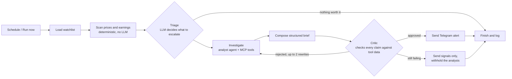

# Financial Analyst Agent

An AI-powered financial research app that lets you pick a company, ask questions in natural language, and receive markdown-formatted financial analysis backed by live Yahoo Finance data through an MCP tool server.

## What the project does

The application has two parts:

1. A React + Vite frontend for selecting a company (with ticker confirmation) and chatting with the analyst.
2. A FastAPI backend that runs a LangGraph agent, connects to an MCP server, resolves company tickers, and asks an LLM to produce the answer.

The agent does not invent financial data. It first maps the company name to a ticker (with user confirmation), then calls financial tools when the model needs real market or statement data.

## Quick Start

### 1. Backend setup

Create and activate a Python environment, then install the backend dependencies:

```powershell
python -m venv venv
.\venv\Scripts\Activate.ps1
pip install -r requirements.txt
```

Create a `.env` file in the repository root with the backend API key expected by the code:

```env
GROQ_API_KEY=YOUR_GROQ_API_KEY
GROQ_MODEL=openai/gpt-oss-120b
ALLOWED_ORIGINS=http://localhost:5173
```

The backend uses `ChatGroq` (via `langchain-groq`) to connect to the Groq API. The model name can be overridden with `GROQ_MODEL`.

Start the FastAPI server:

```powershell
uvicorn main:app --reload --host 0.0.0.0 --port 8000
```

### 2. Frontend setup

Install frontend dependencies and start Vite:

```powershell
cd frontend
npm install
npm run dev
```

Create a frontend environment file so the UI knows where the backend is running:

```env
VITE_API_URL=http://localhost:8000
```

If your backend is hosted elsewhere, point `VITE_API_URL` at that base URL instead.

### 3. Open the app

Open the Vite URL shown in the terminal, enter a company name, select the correct listing from the dropdown, and start asking questions.

## Full Run Workflow

```mermaid
graph TD
  A[User enters company in CompanySetup] --> B[/resolve returns matching tickers]
  B --> C[User confirms correct listing]
  C --> D[App stores company + ticker and opens ChatWindow]
  D --> E[User asks a question]
  E --> F[ChatWindow POSTs company, ticker, question to /analyze]
  F --> G[FastAPI uses cached LangGraph]
  G --> H[analyst_node calls LLM with tools]
  H --> I{Tool needed?}
  I -- yes --> J[ToolNode executes MCP financial tools]
  J --> H
  I -- no --> K[Final assistant message returned]
  K --> L[ChatWindow renders markdown response]
```

## Agentic Workflow

This project uses a small agent loop rather than a single prompt-response call.

1. The frontend sends the selected company, ticker, and the user's question to the backend.
2. The graph runs `analyst_node`, which creates the LLM, attaches the available tools, and sends a system prompt that tells the model to use tools whenever real financial data is required.
3. If the model requests a tool, LangGraph routes execution to the `ToolNode`.
4. Tool calls are served by the MCP server in `mcp_server/financial_tools.py`, which fetches data from Yahoo Finance through `yfinance`.
5. The graph loops back into the analyst node until the model produces a final answer, with a hard cap of 6 tool calls per turn.
6. If the cap is hit, a `final_answer` node synthesizes a response from the data already gathered.

The important design choice is that the LLM is not trusted as the source of record for financial facts. It is the reasoning layer, while the MCP tools are the data layer.

## MCP Server

The backend launches the MCP server from `mcp_server/financial_tools.py` using `MultiServerMCPClient` in `graph.py`.

Current tools exposed by the server:

1. `get_financials(ticker, period)` - returns the Yahoo Finance income statement. `period` is `"annual"` (default) or `"quarterly"`.
2. `get_balance_sheet(ticker, period)` - returns the Yahoo Finance balance sheet, annual or quarterly.
3. `get_cash_flow(ticker, period)` - returns the Yahoo Finance cash flow statement, annual or quarterly.
4. `get_market_data(ticker)` - returns current price, market cap, 52-week range, volume and valuation multiples from Yahoo Finance.

### How the server is launched

The backend launches the MCP server from `mcp_server/financial_tools.py` using `MultiServerMCPClient` in `graph.py`.

The server runs as a **long-lived Streamable HTTP process on localhost** (default `127.0.0.1:8931`), started once by the backend and reused for the lifetime of the process. The compiled LangGraph is also cached, so tool discovery runs once instead of on every request.

This matters for two reasons:

- **Caching.** The MCP server keeps a TTL cache of fetched data (default 900s), so asking the same question twice does not hit Yahoo Finance twice. This only works because the server process persists; with a stdio transport the adapter spawns a fresh process per tool call and the cache would be useless.
- **Rate limits.** Yahoo Finance throttles aggressive clients. The server fetches the heavy `Ticker.info` profile only as a fallback and otherwise uses the lighter `fast_info` and `get_valuation_measures()` endpoints.

If the HTTP server fails to start within `MCP_STARTUP_TIMEOUT` seconds, the backend silently falls back to a stdio transport. The tools still work, but the cache is lost.

## Data Shape and Period Handling

Statement tools return an explicit shape so the model cannot mislabel a figure:

```json
{
  "ticker": "NVDA",
  "source": "income_stmt_quarterly",
  "frequency": "quarterly",
  "periods": ["2026-07-31", "2026-04-30", "..."],
  "data": { "2026-07-31": { "Total Revenue": 96221000000.0 } },
  "currency": "USD"
}
```

`periods` lists the most recent reporting dates first, and `data` maps each period to its line items. The `currency` field indicates the reporting currency.

- Annual and quarterly data are fetched from different Yahoo Finance attributes. Asking for "quarterly revenue" returns `quarterly_income_stmt`; asking for annual returns `income_stmt`. They are never mixed.
- Only the most recent `FIN_TOOL_PERIODS` periods are returned.
- Missing values are `null`, never `NaN`, and all output is valid JSON.

## Error Handling

- A rate limit returns `{"error": ..., "retryable": false, "advice": "..."}`. The advice field tells the model to stop calling the tool and report unavailability rather than retrying, which is what previously caused the same tool to be called repeatedly.
- Successful results include `"cached": true` when served from the TTL cache.
- Empty statements return a `note` instead of an error.
- Any other exception returns `{"error": ..., "ticker": ...}` with `retryable: false`.

## Autonomous Monitor

Beyond answering questions, the project runs as an autonomous agent. On a schedule (and on demand) it
watches a personal watchlist, decides what is worth investigating, researches it with the same analyst
agent and tools used in the chat, fact-checks its own write-up, and sends an alert.



What makes it agentic rather than a chatbot:

- **Autonomous trigger.** A cron job wakes it up; nobody types a question.
- **Judgment about when to act.** Deterministic triggers (large moves, earnings soon) pick candidates,
  a cooldown prevents repeat alerts, and an LLM triage step decides which candidates deserve the cost of a deep dive.
- **Real action.** It sends Telegram alerts and writes every decision to a database.
- **Verification loop.** A separate critic step checks the brief against the raw tool output. A rejected
  brief is sent back to the analyst with the specific problems. If it never passes, only the computed
  market signals are sent and the model's text is withheld.
- **Code does the arithmetic.** The `calculate` MCP tool evaluates every ratio and growth figure so the model does not guess at math.
- **Self-evaluation.** Each alert records the price and the model's stance. After `MONITOR_OUTCOME_DAYS`
  days the outcome is scored, giving a running hit rate and average return (neutral and unverified alerts are not scored).
- **Safe failure.** If a run crashes, or no ticker can be priced, the run is marked failed and you are notified instead of getting silence.

### Setup

1. **Database.** Create a free Postgres database (for example on Neon) and copy its connection string into
   `DATABASE_URL` on the backend host and as a GitHub Actions secret. Without it a local SQLite file is used, which free hosts wipe on redeploy.
2. **Owner token.** Generate a long random value for `OWNER_TOKEN` (see `.env.example`) and set it on the backend. You paste it once into the Monitor page. Without it the owner endpoints are disabled.
3. **Telegram.** Create a bot with `@BotFather`, send it a message, then open
   `https://api.telegram.org/bot<TOKEN>/getUpdates` to find your chat id. Set `TELEGRAM_BOT_TOKEN` and `TELEGRAM_CHAT_ID`. Without them alerts are only logged.
4. **GitHub secrets** (repo Settings, Secrets and variables, Actions): `DATABASE_URL`, `GROQ_API_KEY`,
   `TELEGRAM_BOT_TOKEN`, `TELEGRAM_CHAT_ID`. The workflow `.github/workflows/monitor.yml` runs weekdays after the Indian and US market closes.
5. Open the app, choose **Autonomous monitor**, enter the token, add tickers, and press **Run scan now** to test.

Run it from a terminal with `python -m monitor.cli run` (scan), `evaluate` (score old alerts) or `all`.

Notes: scheduled workflows on public repositories are paused by GitHub after 60 days without repository
activity. Yahoo Finance sometimes rate limits shared cloud IPs; if that happens the run fails loudly (you get a Telegram message)
and you can trigger `POST /monitor/run` from the backend host instead. On Groq's free tier keep the watchlist small or lower
`MONITOR_MAX_INVESTIGATIONS`, because each investigation makes several model calls.

### Monitor API (owner only, `Authorization: Bearer <OWNER_TOKEN>`)

| Endpoint | Purpose |
| --- | --- |
| `GET /watchlist`, `POST /watchlist`, `DELETE /watchlist/{ticker}` | Manage the watchlist (max 25 tickers) |
| `POST /monitor/run` | Start a scan in the background (409 if one is already running) |
| `GET /monitor/runs`, `GET /monitor/alerts` | Run history and alert history |
| `GET /monitor/stats` | Track record: alerts, scored, hit rate, average signed return |

### Monitor files

- `monitor/signals.py` - price and earnings signals and the trigger rules (pure functions, no LLM).
- `monitor/agents.py` - triage, compose and critic steps with retries and safe fallbacks.
- `monitor/graph.py` - the LangGraph workflow above.
- `monitor/db.py` - watchlist, runs and alerts (SQLAlchemy; SQLite or Postgres).
- `monitor/notify.py` - Telegram delivery (log-only fallback) and alert formatting.
- `monitor/outcomes.py` - scores past alerts against the actual price move.
- `monitor/runner.py`, `monitor/cli.py`, `monitor/api.py` - entry points: scheduled, command line and HTTP.

## Project Structure

### Root backend files

- `main.py` - FastAPI entry point with the `/` health check, `/resolve` ticker search, and the `/analyze` endpoint. Includes CORS, rate limiting (10/min), request validation, and streaming error handling.
- `graph.py` - Starts the MCP tool server, builds the LangGraph (analyst node, tool node, final_answer node), caches the compiled graph, and shuts the server down. Includes tool-call budget (max 6 per turn).
- `analyst.py` - Creates the LLM, binds tools once, injects the system prompt (constant), and returns the assistant response. Uses async `ainvoke`.
- `state.py` - Defines the shared LangGraph state shape (`AgentState` with company, ticker, messages). Provides `create_initial_state()` factory.
- `user_input.py` - Resolves a company name to ticker candidates using Yahoo Finance search (15-minute dict cache, case-insensitive). Returns top 5 equity results with symbol, name, exchange.
- `requirements.txt` - Python dependencies for the backend and MCP server (pinned versions).

### MCP server files

- `mcp_server/financial_tools.py` - MCP tool definitions that fetch financial statements and market data from Yahoo Finance. Converts pandas/NumPy output to strictly valid JSON, caches results with TTL + size eviction, distinguishes rate-limit errors, validates ticker format, fetches currency from `get_info()`, runs async via `asyncio.to_thread()`.

### Frontend files

- `frontend/package.json` - Frontend scripts and package dependencies.
- `frontend/vite.config.js` - Vite configuration with React and Tailwind support.
- `frontend/eslint.config.js` - ESLint configuration for JavaScript and JSX.
- `frontend/index.html` - Vite HTML shell that mounts the React app.
- `frontend/src/main.jsx` - React bootstrap file that mounts the app.
- `frontend/src/App.jsx` - Controls the company setup screen and the chat screen.
- `frontend/src/index.css` - Global styles for the frontend.
- `frontend/src/components/CompanySetup.jsx` - First screen where the user enters a company name and selects from resolved tickers.
- `frontend/src/components/ChatWindow.jsx` - Chat interface with streaming, tool chips, cancellation (AbortController), capped history, error handling, suggestion array, smooth/auto scroll.
- `frontend/src/components/ChatMessage.jsx` - Markdown message renderer with tool chips, error styling, and code block support.

## How the Frontend Works

The React app starts in `frontend/src/main.jsx`, which renders `frontend/src/App.jsx`.

`App.jsx` manages one simple state transition:

1. Before a company is chosen, it renders `CompanySetup`.
2. After the company and ticker are submitted, it renders `ChatWindow` with the selected company name and ticker.

Inside `CompanySetup`:

1. User types a company name (e.g., "NVIDIA").
2. On each keystroke, `/resolve?q=` is called with a 350 ms debounce timer.
3. Results show as clickable cards with name, symbol, and exchange.
4. User clicks the correct one, then "Start Analysis".

Inside `ChatWindow`:

1. The user types a question or clicks a suggestion.
2. The component immediately appends the user message to local chat state.
3. It POSTs `{ company, ticker, question, messages }` to `${VITE_API_URL}/analyze`.
4. It receives NDJSON stream: `token`, `tool_call`, `done`, or `error` events.
5. Tool calls render as chips above the assistant message.
6. Errors show inline with partial content preserved.
7. User can cancel an in-flight request.

## How the Backend Works

The backend entry point is `main.py`.

### Request flow

1. `GET /` returns a simple health payload.
2. `GET /resolve?q=` returns up to 5 equity ticker matches for the query.
3. `POST /analyze` receives a company name, ticker, question, and optional message history.
4. The endpoint uses the cached graph from `create_graph()`.
5. A fresh initial state is assembled with the company, ticker, and the user's message (plus capped history).
6. `graph.astream(...)` runs the agent pipeline and streams NDJSON events back.

### Why the graph is built once and reused

`create_graph()` caches the compiled graph and the MCP client at module level, so the MCP server subprocess and the financial-data cache survive across requests. Building the graph per request meant a new subprocess and an empty cache for every question. `close_graph()` terminates the server process on application shutdown.

### Security & Reliability

- **Request validation**: `AnalysisRequest` enforces min/max lengths, ticker regex (`^[A-Za-z0-9.\-^=]{1,15}$`), role allowlist (`user`/`assistant`), max 12 history messages.
- **CORS**: Restricted to `ALLOWED_ORIGINS` env var (default `http://localhost:5173`).
- **Rate limiting**: 10 requests/minute via `slowapi`.
- **Fail fast**: Startup fails if `GROQ_API_KEY` not set.
- **Error streaming**: Graph creation moved inside stream; generic error messages with server-side logging.
- **No keep-alive**: Removed self-ping; use UptimeRobot (free) against `GET /`.

## File-by-File Details

### `main.py`
- Defines the FastAPI app.
- Configures CORS for allowed origins.
- Exposes health route, `/resolve` ticker search, and `/analyze` endpoint.
- Starts the LangGraph pipeline for each analysis request with streaming error handling.

### `graph.py`
- Creates a `MultiServerMCPClient` that launches `mcp_server/financial_tools.py`.
- Loads the tools from the MCP server.
- Creates a `StateGraph` using the shared `AgentState`.
- Adds nodes: `analyst` (with bound tools), `tools` (ToolNode), `final_answer` (no tools).
- Wires the graph with a tool-call budget (`MAX_TOOL_CALLS=6`) and `final_answer` fallback.
- Implements double-checked locking for thread-safe graph initialization.

### `analyst.py`
- Loads environment variables with `python-dotenv`.
- Creates the LLM client (cached via `@lru_cache`).
- Binds the MCP tools to the model **once** at graph creation time.
- Supplies a system prompt (module constant) that instructs the model to use tools for real data, never repeat tool calls, respect `retryable: false`, and state currency/period for every figure.
- Uses async `ainvoke` for non-blocking LLM calls.

### `state.py`
- Defines the `AgentState` TypedDict (company, ticker, messages).
- Uses LangGraph message accumulation so the conversation history is preserved across tool loops.
- Provides `create_initial_state()` factory function.

### `user_input.py`
- Uses Yahoo Finance search to find matching tickers for the selected company.
- 15-minute dict cache (case-insensitive), returns top 5 equity results with symbol, name, exchange.

### `mcp_server/financial_tools.py`
- Defines the MCP server with `FastMCP`.
- Wraps Yahoo Finance reads into callable async tools.
- Converts pandas/NumPy output to strictly valid JSON via `_json_safe`.
- Caches results with TTL (default 900s) and size-based eviction (max 256 entries).
- Distinguishes rate-limit errors with `retryable: false` and advice.
- Validates ticker format against regex.
- Fetches `financialCurrency` from `get_info()` and includes `currency` in statement outputs.
- Runs as a persistent Streamable HTTP server, or over stdio if requested.

### `frontend/src/components/CompanySetup.jsx`
- Renders the company entry screen with live ticker search via `/resolve`.
- Shows candidate tickers as clickable cards (name, symbol, exchange).
- Prevents empty submissions; requires user to pick a result.

### `frontend/src/components/ChatWindow.jsx`
- Holds the user conversation state.
- Sends the backend request with capped history (last 10 non-error messages).
- Shows loading state with bouncing dots.
- Renders tool calls as chips, errors inline with partial content.
- Implements `AbortController` for cancellation.
- Suggestion buttons rendered from a `SUGGESTIONS` array.
- Auto-scroll on new messages, smooth scroll on user interaction.

### `frontend/src/components/ChatMessage.jsx`
- Renders user and assistant messages differently.
- Displays tool chips above assistant content.
- Uses `react-markdown` and `remark-gfm` to support markdown tables, lists, blockquotes, and code.
- Custom `pre`/`code` styling for code blocks.

### `frontend/src/main.jsx`
- Mounts the React app into the root DOM node.

## API Endpoints

### `GET /`
Health check.

Response:
```json
{ "status": "ok" }
```

### `GET /resolve?q=`
Search for equity tickers matching a query.

Query params:
- `q` (string, min 1, max 80) - company name to search

Response:
```json
{
  "results": [
    { "symbol": "NVDA", "name": "NVIDIA Corporation", "exchange": "NASDAQ" },
    ...
  ]
}
```

### `POST /analyze`

Request body:
```json
{
  "company": "NVIDIA",
  "ticker": "NVDA",
  "question": "Evaluate NVIDIA profitability",
  "messages": [
    { "role": "user", "content": "previous question" },
    { "role": "assistant", "content": "previous answer" }
  ]
}
```

Constraints:
- `company`: 1-80 chars
- `ticker`: regex `^[A-Za-z0-9.\-^=]{1,15}$`
- `question`: 1-1000 chars
- `messages`: max 12 items, each `role` in `["user", "assistant"]`, `content` max 4000 chars

Response: NDJSON stream (one JSON object per line)
- `{"type": "token", "content": "..."}` — a chunk of the assistant's response text
- `{"type": "tool_call", "tool": "get_financials"}` — a tool was called
- `{"type": "done"}` — signals the end of the response
- `{"type": "error", "content": "..."}` — signals a failure

Rate limit: 10 requests/minute per IP.

## Environment Variables

Copy `.env.example` to `.env` and fill in the values. See `.env.example` for the full list with defaults.

### Backend (root `.env`)

- `GROQ_API_KEY` - **required** for the Groq LLM client.
- `GROQ_MODEL` - the Groq model to use (defaults to `openai/gpt-oss-120b`).
- `ALLOWED_ORIGINS` - comma-separated CORS origins (default `http://localhost:5173`).
- `MCP_HOST` / `MCP_PORT` - host and port for the local MCP tool server (default `127.0.0.1:8931`).
- `MCP_TRANSPORT` - set internally (streamable-http with stdio fallback); don't set manually.
- `MCP_STARTUP_TIMEOUT` - seconds to wait for HTTP server before fallback (default `20`).
- `DATABASE_URL` - Postgres/SQLite URL for the watchlist and alerts (defaults to a local SQLite file).
- `OWNER_TOKEN` - bearer token for the watchlist and monitor endpoints (they are disabled if unset).
- `TELEGRAM_BOT_TOKEN` / `TELEGRAM_CHAT_ID` - where alerts are delivered (log-only if unset).
- `MONITOR_*` - optional thresholds and limits, listed in `.env.example`.
- `FIN_TOOL_PERIODS` - how many recent reporting periods each statement tool returns (default `8`).
- `FIN_TOOL_CACHE_TTL` - seconds to cache financial data in the tool server (default `900`).
- `FIN_TOOL_RETRY_BACKOFF` - seconds to wait before retrying once after a rate limit (default `3`).

### Frontend (`frontend/.env`)

- `VITE_API_URL` - base URL for the FastAPI server (default `http://localhost:8000`).

## Useful Commands

### Backend
```powershell
uvicorn main:app --reload
```

### Frontend
```powershell
cd frontend
npm run dev
npm run build
npm run lint
```

## Notes

- The app depends on network access to Yahoo Finance and the configured LLM provider.
- If the frontend cannot reach the backend, check `VITE_API_URL` and make sure FastAPI is running.
- The backend binds an extra localhost port (`MCP_PORT`, default 8931) for the MCP tool server. It does not need to be exposed publicly, and no firewall rule is required.
- If the MCP server cannot bind that port, the backend falls back to a stdio transport. Everything keeps working but the financial-data cache is lost.
- Yahoo Finance rate-limits aggressive use. The tool server caches results and avoids the heaviest endpoints to stay under the limit, but a heavily used shared deployment can still be throttled.
- The frontend expects markdown-formatted answers, so the assistant output is rendered with markdown support instead of plain text.

## Extending The Project

If you want to add more tools, expand the MCP server and expose new functions through `FastMCP`. The LangGraph workflow will pick them up through the MCP client as long as they are registered and returned by tool discovery.

If you want to support additional data sources, the safest place to add them is the MCP layer, not inside the prompt. That keeps external data access explicit and easier to test.