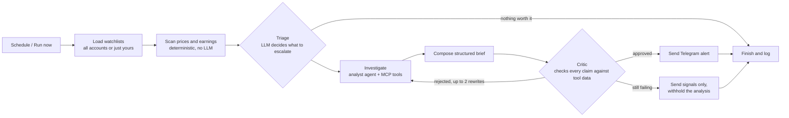

# Financial Analyst Agent

An AI-powered financial research app that lets you create an account, pick a company, ask questions in natural language, and receive markdown-formatted financial analysis backed by live Yahoo Finance data through an MCP tool server. Every conversation is saved to your account history, and an autonomous monitor watches your personal watchlist and sends fact-checked alerts.

## What the project does

The application has two parts:

1. A React + Vite frontend with email/password accounts, saved conversation history, a dark research workspace, and the autonomous monitor dashboard.
2. A FastAPI backend that runs a LangGraph agent, connects to an MCP server, resolves company tickers, stores per-account data (users, sessions, conversations, watchlists, alerts), and asks an LLM to produce the answer.

The agent does not invent financial data. It first maps the company name to a ticker (with user confirmation), then calls financial tools when the model needs real market or statement data.

## Quick Start

### 1. Backend setup

Create and activate a Python environment, then install the backend dependencies:

```powershell
python -m venv venv
.\venv\Scripts\Activate.ps1
pip install -r requirements.txt
```

Create a `.env` file in the repository root with the backend API key expected by the code:

```env
GROQ_API_KEY=YOUR_GROQ_API_KEY
GROQ_MODEL=openai/gpt-oss-120b
ALLOWED_ORIGINS=http://localhost:5173
```

The backend uses `ChatGroq` (via `langchain-groq`) to connect to the Groq API. The model name can be overridden with `GROQ_MODEL`.

Start the FastAPI server:

```powershell
uvicorn main:app --reload --host 0.0.0.0 --port 8000
```

### 2. Frontend setup

Install frontend dependencies and start Vite:

```powershell
cd frontend
npm install
npm run dev
```

Create a frontend environment file so the UI knows where the backend is running:

```env
VITE_API_URL=http://localhost:8000
```

If your backend is hosted elsewhere, point `VITE_API_URL` at that base URL instead.

### 3. Open the app

Open the Vite URL shown in the terminal, create an account (email + password), then search for a company, select the correct listing, and start asking questions. Everything you ask is saved to your history in the sidebar.

## Accounts and Chat History

There is no shared owner secret anymore. The first screen is a sign-up/sign-in form and every API call is bound to the signed-in account:

- Passwords are hashed with `scrypt` (standard library) and sessions are opaque tokens; only a SHA-256 hash of each token is stored in the database (`AUTH_SESSION_DAYS` controls the lifetime, default 30 days).
- `POST /analyze` records each question and answer into a per-account, per-ticker conversation. The sidebar lists conversations; opening one restores its messages, and they can be deleted.
- The watchlist, monitor runs, alerts and track record are all per account. "Run scan now" scans only your tickers; the scheduled GitHub Action scans every account's watchlist together and records each alert for the accounts that watch that ticker.
- Alert cooldowns are per account, so a ticker you were just alerted about does not block another account's alert.

## Full Run Workflow

```mermaid
graph TD
  A[User signs up or signs in] --> B[AuthScreen returns a session token]
  B --> C[User enters company in NewAnalysis]
  C --> D[/resolve returns matching tickers]
  D --> E[User confirms correct listing]
  E --> F[App opens ChatPanel for company + ticker]
  F --> G[User asks a question]
  G --> H[ChatPanel POSTs company, ticker, question to /analyze with the session token]
  H --> I[FastAPI records the question in the account history]
  I --> J[FastAPI uses cached LangGraph]
  J --> K[analyst_node calls LLM with tools]
  K --> L{Tool needed?}
  L -- yes --> M[ToolNode executes MCP financial tools]
  M --> K
  L -- no --> N[Final assistant message streamed]
  N --> O[Answer saved to the conversation; sidebar history refreshes]
```

## Agentic Workflow

This project uses a small agent loop rather than a single prompt-response call.

1. The frontend sends the selected company, ticker, the user's question, and the session token to `/analyze`.
2. The backend saves the question to the account's conversation for that ticker.
3. The graph runs `analyst_node`, which creates the LLM, attaches the available tools, and sends a system prompt that tells the model to use tools whenever real financial data is required.
4. If the model requests a tool, LangGraph routes execution to the `ToolNode`.
5. Tool calls are served by the MCP server in `mcp_server/financial_tools.py`, which fetches data from Yahoo Finance through `yfinance`.
6. The graph loops back into the analyst node until the model produces a final answer, with a hard cap of 6 tool calls per turn.
7. If the cap is hit, a `final_answer` node synthesizes a response from the data already gathered.
8. When the stream finishes, the answer (including which tools were used) is saved to the conversation.

The important design choice is that the LLM is not trusted as the source of record for financial facts. It is the reasoning layer, while the MCP tools are the data layer.

## MCP Server

The backend launches the MCP server from `mcp_server/financial_tools.py` using `MultiServerMCPClient` in `graph.py`.

Current tools exposed by the server:

1. `get_financials(ticker, period)` - returns the Yahoo Finance income statement. `period` is `"annual"` (default) or `"quarterly"`.
2. `get_balance_sheet(ticker, period)` - returns the Yahoo Finance balance sheet, annual or quarterly.
3. `get_cash_flow(ticker, period)` - returns the Yahoo Finance cash flow statement, annual or quarterly.
4. `get_market_data(ticker)` - returns current price, market cap, 52-week range, volume and valuation multiples from Yahoo Finance.

### How the server is launched

The backend launches the MCP server from `mcp_server/financial_tools.py` using `MultiServerMCPClient` in `graph.py`.

The server runs as a **long-lived Streamable HTTP process on localhost** (default `127.0.0.1:8931`), started once by the backend and reused for the lifetime of the process. The compiled LangGraph is also cached, so tool discovery runs once instead of on every request.

This matters for two reasons:

- **Caching.** The MCP server keeps a TTL cache of fetched data (default 900s), so asking the same question twice does not hit Yahoo Finance twice. This only works because the server process persists; with a stdio transport the adapter spawns a fresh process per tool call and the cache would be useless.
- **Rate limits.** Yahoo Finance throttles aggressive clients. The server fetches the heavy `Ticker.info` profile only as a fallback and otherwise uses the lighter `fast_info` and `get_valuation_measures()` endpoints.

If the HTTP server fails to start within `MCP_STARTUP_TIMEOUT` seconds, the backend silently falls back to a stdio transport. The tools still work, but the cache is lost.

## Data Shape and Period Handling

Statement tools return an explicit shape so the model cannot mislabel a figure:

```json
{
  "ticker": "NVDA",
  "source": "income_stmt_quarterly",
  "frequency": "quarterly",
  "periods": ["2026-07-31", "2026-04-30", "..."],
  "data": { "2026-07-31": { "Total Revenue": 96221000000.0 } },
  "currency": "USD"
}
```

`periods` lists the most recent reporting dates first, and `data` maps each period to its line items. The `currency` field indicates the reporting currency.

- Annual and quarterly data are fetched from different Yahoo Finance attributes. Asking for "quarterly revenue" returns `quarterly_income_stmt`; asking for annual returns `income_stmt`. They are never mixed.
- Only the most recent `FIN_TOOL_PERIODS` periods are returned.
- Missing values are `null`, never `NaN`, and all output is valid JSON.

## Error Handling

- A rate limit returns `{"error": ..., "retryable": false, "advice": "..."}`. The advice field tells the model to stop calling the tool and report unavailability rather than retrying, which is what previously caused the same tool to be called repeatedly.
- Successful results include `"cached": true` when served from the TTL cache.
- Empty statements return a `note` instead of an error.
- Any other exception returns `{"error": ..., "ticker": ...}` with `retryable: false`.

## Autonomous Monitor

Beyond answering questions, the project runs as an autonomous agent. On a schedule (and on demand) it
watches each account's watchlist, decides what is worth investigating, researches it with the same analyst
agent and tools used in the chat, fact-checks its own write-up, and sends an alert that is stored in the
history of every account watching that ticker.



What makes it agentic rather than a chatbot:

- **Autonomous trigger.** A cron job wakes it up; nobody types a question.
- **Judgment about when to act.** Deterministic triggers (large moves, earnings soon) pick candidates,
  a per-account cooldown prevents repeat alerts, and an LLM triage step decides which candidates deserve the cost of a deep dive.
- **Real action.** It sends Telegram alerts and writes every decision to a database.
- **Verification loop.** A separate critic step checks the brief against the raw tool output. A rejected
  brief is sent back to the analyst with the specific problems. If it never passes, only the computed
  market signals are sent and the model's text is withheld.
- **Code does the arithmetic.** The `calculate` MCP tool evaluates every ratio and growth figure so the model does not guess at math.
- **Self-evaluation.** Each alert records the price and the model's stance. After `MONITOR_OUTCOME_DAYS`
  days the outcome is scored, giving a running hit rate and average return (neutral and unverified alerts are not scored).
- **Safe failure.** If a run crashes, or no ticker can be priced, the run is marked failed and you are notified instead of getting silence.

### Setup

1. **Database.** Create a free Postgres database (for example on Neon) and copy its connection string into
   `DATABASE_URL` on the backend host and as a GitHub Actions secret. Without it a local SQLite file is used, which free hosts wipe on redeploy.
2. **Accounts.** Nothing to configure: users sign up on the landing screen. Each account has its own watchlist, runs, alerts, history and track record. Existing pre-accounts databases are upgraded on startup: the old shared watchlist table is rebuilt (it belonged to no account) and `runs`/`alerts` gain a nullable `user_id` column whose old rows stay visible only to system queries.
3. **Telegram.** Create a bot with `@BotFather`, send it a message, then open
   `https://api.telegram.org/bot<TOKEN>/getUpdates` to find your chat id. Set `TELEGRAM_BOT_TOKEN` and `TELEGRAM_CHAT_ID`. Without them alerts are only logged and stored in each account's history. Scheduled alerts for every account are delivered to this single chat.
4. **GitHub secrets** (repo Settings, Secrets and variables, Actions): `DATABASE_URL`, `GROQ_API_KEY`,
   `TELEGRAM_BOT_TOKEN`, `TELEGRAM_CHAT_ID`. The workflow `.github/workflows/monitor.yml` runs weekdays after the Indian and US market closes and scans every account's watchlist.
5. Open the app, sign in, choose **Autonomous monitor**, add tickers, and press **Run scan now** to test.

Run it from a terminal with `python -m monitor.cli run` (scan), `evaluate` (score old alerts) or `all`.

Notes: scheduled workflows on public repositories are paused by GitHub after 60 days without repository
activity. Yahoo Finance sometimes rate limits shared cloud IPs; if that happens the run fails loudly (you get a Telegram message)
and you can trigger `POST /monitor/run` from the backend host instead. On Groq's free tier keep the watchlist small or lower
`MONITOR_MAX_INVESTIGATIONS`, because each investigation makes several model calls.

### Monitor API (signed in, `Authorization: Bearer <session token>`)

Every endpoint is scoped to the signed-in account. The session token comes from `POST /auth/login` or `POST /auth/register`.

| Endpoint | Purpose |
| --- | --- |
| `GET /watchlist`, `POST /watchlist`, `DELETE /watchlist/{ticker}` | Manage your watchlist (max 25 tickers per account) |
| `POST /monitor/run` | Scan your watchlist in the background (409 if a run is already in progress) |
| `GET /monitor/runs`, `GET /monitor/alerts` | Your run history and alert history |
| `GET /monitor/stats` | Your track record: alerts, scored, hit rate, average signed return |

### Monitor files

- `auth.py` - accounts, scrypt password hashing, database-backed sessions, the `get_current_user` dependency, and the `/auth` routes.
- `history.py` - `GET /conversations`, `GET /conversations/{id}`, `DELETE /conversations/{id}` for saved chat history.
- `monitor/signals.py` - price and earnings signals and the trigger rules (pure functions, no LLM).
- `monitor/agents.py` - triage, compose and critic steps with retries and safe fallbacks.
- `monitor/graph.py` - the LangGraph workflow above.
- `monitor/db.py` - watchlist, runs and alerts (SQLAlchemy; SQLite or Postgres).
- `monitor/notify.py` - Telegram delivery (log-only fallback) and alert formatting.
- `monitor/outcomes.py` - scores past alerts against the actual price move.
- `monitor/runner.py`, `monitor/cli.py`, `monitor/api.py` - entry points: scheduled, command line and HTTP.

## Project Structure

### Root backend files

- `main.py` - FastAPI entry point with the `/` health check, `/resolve` ticker search, and the `/analyze` endpoint. Requires a signed-in account, records conversations, and includes CORS, rate limiting, request validation, and streaming error handling.
- `auth.py` - Sign-up/sign-in/sign-out/me routes, scrypt password hashing, database-backed sessions, and the `get_current_user` dependency that protects every personal endpoint.
- `history.py` - Chat history routes: list conversations, read one, delete one (per account).
- `graph.py` - Starts the MCP tool server, builds the LangGraph (analyst node, tool node, final_answer node), caches the compiled graph, and shuts the server down. Includes tool-call budget (max 6 per turn).
- `analyst.py` - Creates the LLM, binds tools once, injects the system prompt (constant), and returns the assistant response. Uses async `ainvoke`.
- `state.py` - Defines the shared LangGraph state shape (`AgentState` with company, ticker, messages). Provides `create_initial_state()` factory.
- `user_input.py` - Resolves a company name to ticker candidates using Yahoo Finance search (15-minute dict cache, case-insensitive). Returns top 5 equity results with symbol, name, exchange.
- `requirements.txt` - Python dependencies for the backend and MCP server (pinned versions).

### MCP server files

- `mcp_server/financial_tools.py` - MCP tool definitions that fetch financial statements and market data from Yahoo Finance. Converts pandas/NumPy output to strictly valid JSON, caches results with TTL + size eviction, distinguishes rate-limit errors, validates ticker format, fetches currency from `get_info()`, runs async via `asyncio.to_thread()`.

### Frontend files

- `frontend/package.json` - Frontend scripts and package dependencies.
- `frontend/vite.config.js` - Vite configuration with React and Tailwind support.
- `frontend/eslint.config.js` - ESLint configuration for JavaScript and JSX.
- `frontend/index.html` - Vite HTML shell that mounts the React app (loads the Inter font and sets the dark background).
- `frontend/src/main.jsx` - React bootstrap file that mounts the app.
- `frontend/src/App.jsx` - Auth gate and workspace shell: sidebar navigation, view switching (new analysis / chat / monitor), and history bookkeeping.
- `frontend/src/index.css` - Tailwind theme tokens, dark background, reusable panel/button/input classes and animations.
- `frontend/src/lib/api.js` - API client: session token storage, JSON requests, error mapping, and the NDJSON stream reader for `/analyze`.
- `frontend/src/lib/auth-context.js` - Auth context and `useAuth` hook.
- `frontend/src/lib/format.js` - Small formatting helpers (timestamps, avatar initials).
- `frontend/src/components/AuthProvider.jsx` - Restores the session and exposes login/register/logout.
- `frontend/src/components/AuthScreen.jsx` - Split-screen brand panel plus sign-in / create-account form.
- `frontend/src/components/Sidebar.jsx` - Navigation, conversation history list with delete, and the account footer.
- `frontend/src/components/NewAnalysis.jsx` - Company search with debounced `/resolve`, listing confirmation, and recent conversations.
- `frontend/src/components/ChatPanel.jsx` - Chat interface: streaming, tool chips, cancellation, saved-history loading, suggestions, and composer.
- `frontend/src/components/MessageBubble.jsx` - User/assistant message rendering with tool chips and streaming cursor.
- `frontend/src/components/Markdown.jsx` - Dark-themed markdown renderer (tables, lists, code, blockquotes).
- `frontend/src/components/MonitorPanel.jsx` - Watchlist management, scan trigger, track-record stats, alerts and run history.
- `frontend/src/components/ui.jsx` - Shared primitives: icons, logo, spinner, field, badge, empty state, error banner.

## How the Frontend Works

The React app starts in `frontend/src/main.jsx`, which renders `frontend/src/App.jsx`.

`App.jsx` wraps everything in `AuthProvider` and gates the workspace:

1. `AuthProvider` restores a session from the stored token (`GET /auth/me`) or shows `AuthScreen` for sign-up/sign-in.
2. After sign-in, `Workspace` renders a fixed sidebar (`Sidebar`) plus one of three views: `NewAnalysis`, `ChatPanel` or `MonitorPanel`.
3. The sidebar loads `GET /conversations` for the history list. Opening a conversation loads its messages into `ChatPanel`; deleting one removes it server-side. The chat view stays mounted when the monitor is open so an in-flight answer is not lost.

Inside `NewAnalysis`:

1. User types a company name (e.g., "NVIDIA").
2. After a 350 ms debounce, `/resolve?q=` is called with the session token.
3. Results show as clickable rows with name, symbol, and exchange.
4. User clicks the correct one, then "Start analysis".

Inside `ChatPanel`:

1. The user types a question or clicks a suggestion.
2. The component immediately appends the user message to local chat state.
3. It streams `POST /analyze` and applies `token`, `tool_call`, `error` and `done` events; the `done` event carries the `conversation_id` used to refresh the sidebar.
4. Tool calls render as chips above the assistant message; markdown renders tables and lists.
5. User can cancel an in-flight request; opening a saved conversation restores its messages from `GET /conversations/{id}`.

Inside `MonitorPanel`:

1. It loads the watchlist, runs, alerts and stats for the signed-in account in parallel.
2. "Run scan now" starts `POST /monitor/run`; while a run is active the panel polls every 4 seconds.
3. Alerts show stance, fact-check status, triggers and the scored outcome after the horizon.

## How the Backend Works

The backend entry point is `main.py`.

### Request flow

1. `GET /` returns a simple health payload (the only public endpoint).
2. `POST /auth/register` / `POST /auth/login` create a session token; `GET /auth/me` resolves it back to an account.
3. `GET /resolve?q=` returns up to 5 equity ticker matches for the query (signed in).
4. `POST /analyze` receives a company name, ticker, question, and optional message history (signed in).
5. The endpoint records the question in the account's conversation for that ticker.
6. The endpoint uses the cached graph from `create_graph()`.
7. A fresh initial state is assembled with the company, ticker, and the user's message (plus capped history).
8. `graph.astream(...)` runs the agent pipeline and streams NDJSON events back.
9. The final answer (with the tools it used) is saved to the same conversation.
10. `GET /conversations`, `GET /conversations/{id}` and `DELETE /conversations/{id}` read and manage saved history; the monitor routes manage the per-account watchlist, runs, alerts and stats.

### Why the graph is built once and reused

`create_graph()` caches the compiled graph and the MCP client at module level, so the MCP server subprocess and the financial-data cache survive across requests. Building the graph per request meant a new subprocess and an empty cache for every question. `close_graph()` terminates the server process on application shutdown.

### Security & Reliability

- **Accounts**: every personal endpoint requires `Authorization: Bearer <session token>`. Passwords are stored as scrypt hashes with a per-user salt; sessions are stored as SHA-256 token hashes with an expiry, so a database leak does not expose passwords or live tokens.
- **Tenant isolation**: watchlists, runs, alerts, stats and conversations are filtered by `user_id` in the queries; opening someone else's conversation returns 404.
- **Request validation**: `AnalysisRequest` enforces min/max lengths, ticker regex (`^[A-Za-z0-9.\-^=]{1,15}$`), role allowlist (`user`/`assistant`), max 12 history messages.
- **CORS**: Restricted to `ALLOWED_ORIGINS` env var (default `http://localhost:5173`).
- **Rate limiting**: 10 requests/minute for `/analyze`, 10/minute for sign-up/sign-in, and per-route limits for the rest via `slowapi`.
- **Fail fast**: Startup fails if `GROQ_API_KEY` not set.
- **Error streaming**: Graph creation moved inside stream; generic error messages with server-side logging.
- **History is best effort**: if the database write fails, the chat answer still streams; the question/answer is simply not saved.
- **No keep-alive**: Removed self-ping; use UptimeRobot (free) against `GET /`.

## File-by-File Details

### `main.py`
- Defines the FastAPI app, includes the auth, history and monitor routers.
- Configures CORS for allowed origins.
- Exposes the public health route plus the signed-in `/resolve` and `/analyze` endpoints.
- Records each question and answer into the account's conversation while streaming.

### `auth.py`
- `hash_password` / `verify_password` using `hashlib.scrypt` and `hmac.compare_digest`.
- `get_current_user` FastAPI dependency: parses the bearer token, hashes it, and resolves the session (rejecting expired ones with 401).
- Routes: `POST /auth/register`, `POST /auth/login`, `POST /auth/logout`, `GET /auth/me`.
- Session lifetime comes from `AUTH_SESSION_DAYS` (default 30); expired sessions are pruned whenever a new one is created.

### `history.py`
- `GET /conversations` lists the account's conversations with message counts and previews.
- `GET /conversations/{id}` returns the full message list (404 for another account's conversation).
- `DELETE /conversations/{id}` removes the conversation and its messages.

### `graph.py`
- Creates a `MultiServerMCPClient` that launches `mcp_server/financial_tools.py`.
- Loads the tools from the MCP server.
- Creates a `StateGraph` using the shared `AgentState`.
- Adds nodes: `analyst` (with bound tools), `tools` (ToolNode), `final_answer` (no tools).
- Wires the graph with a tool-call budget (`MAX_TOOL_CALLS=6`) and `final_answer` fallback.
- Implements double-checked locking for thread-safe graph initialization.

### `analyst.py`
- Loads environment variables with `python-dotenv`.
- Creates the LLM client (cached via `@lru_cache`).
- Binds the MCP tools to the model **once** at graph creation time.
- Supplies a system prompt (module constant) that instructs the model to use tools for real data, never repeat tool calls, respect `retryable: false`, and state currency/period for every figure.
- Uses async `ainvoke` for non-blocking LLM calls.

### `state.py`
- Defines the `AgentState` TypedDict (company, ticker, messages).
- Uses LangGraph message accumulation so the conversation history is preserved across tool loops.
- Provides `create_initial_state()` factory function.

### `user_input.py`
- Uses Yahoo Finance search to find matching tickers for the selected company.
- 15-minute dict cache (case-insensitive), returns top 5 equity results with symbol, name, exchange.

### `mcp_server/financial_tools.py`
- Defines the MCP server with `FastMCP`.
- Wraps Yahoo Finance reads into callable async tools.
- Converts pandas/NumPy output to strictly valid JSON via `_json_safe`.
- Caches results with TTL (default 900s) and size-based eviction (max 256 entries).
- Distinguishes rate-limit errors with `retryable: false` and advice.
- Validates ticker format against regex.
- Fetches `financialCurrency` from `get_info()` and includes `currency` in statement outputs.
- Runs as a persistent Streamable HTTP server, or over stdio if requested.

### `frontend/src/components/AuthScreen.jsx`
- Split-screen sign-in / create-account form with validation feedback.
- Calls `register`/`login` from the auth context; the token is stored in `localStorage`.

### `frontend/src/components/Sidebar.jsx`
- Primary navigation (new analysis, monitor), conversation history with per-item delete, and account footer with sign-out.

### `frontend/src/components/ChatPanel.jsx`
- Holds the conversation state; loads saved history when a conversation is opened.
- Streams `POST /analyze` with capped client history (last 10 non-error messages).
- Renders streaming tokens, tool chips and inline errors; supports cancellation via `AbortController`.
- Reports the returned `conversation_id` so the sidebar refreshes.

### `frontend/src/components/Markdown.jsx`
- Uses `react-markdown` and `remark-gfm` with dark-theme components for tables, lists, code and blockquotes.

### `frontend/src/main.jsx`
- Mounts the React app into the root DOM node.

## API Endpoints

Every endpoint except `GET /` requires `Authorization: Bearer <session token>`.

### `GET /`
Health check. The only public endpoint.

Response:
```json
{ "status": "ok" }
```

### `POST /auth/register`
Create an account. Body: `{ "email": "...", "password": "..." (min 8 chars), "name": "..." (optional) }`.

Response `201`:
```json
{ "token": "…", "user": { "id": 1, "email": "you@example.com", "name": "You", "created_at": "…" } }
```
Errors: `409` if the email is taken, `422` for an invalid email or short password.

### `POST /auth/login`
Sign in. Body: `{ "email": "...", "password": "..." }`. Response `200`: same shape as register. `401` on bad credentials.

### `POST /auth/logout`
Invalidates the current session token. Response `200`: `{ "status": "ok" }`.

### `GET /auth/me`
Returns the signed-in account: `{ "user": { "id": …, "email": …, "name": … } }`.

### `GET /resolve?q=`
Search for equity tickers matching a query.

Query params:
- `q` (string, min 1, max 80) - company name to search

Response:
```json
{
  "results": [
    { "symbol": "NVDA", "name": "NVIDIA Corporation", "exchange": "NASDAQ" },
    ...
  ]
}
```

### `POST /analyze`

Request body:
```json
{
  "company": "NVIDIA",
  "ticker": "NVDA",
  "question": "Evaluate NVIDIA profitability",
  "messages": [
    { "role": "user", "content": "previous question" },
    { "role": "assistant", "content": "previous answer" }
  ]
}
```

Constraints:
- `company`: 1-80 chars
- `ticker`: regex `^[A-Za-z0-9.\-^=]{1,15}$`
- `question`: 1-1000 chars
- `messages`: max 12 items, each `role` in `["user", "assistant"]`, `content` max 4000 chars

Response: NDJSON stream (one JSON object per line)
- `{"type": "token", "content": "..."}` — a chunk of the assistant's response text
- `{"type": "tool_call", "tool": "get_financials"}` — a tool was called
- `{"type": "done", "conversation_id": 7}` — end of response; `conversation_id` is null if history could not be written
- `{"type": "error", "content": "..."}` — signals a failure

Both the question and the final answer are saved to the account's conversation for that ticker.

Rate limit: 10 requests/minute per IP.

### `GET /conversations?limit=30`
The account's conversations, newest first: `{ "items": [{ "id", "ticker", "company", "created_at", "updated_at", "message_count", "preview" }] }`.

### `GET /conversations/{id}`
Full message list for one conversation: `{ "conversation_id": 7, "messages": [{ "id", "role", "content", "tools", "error", "created_at" }] }`. `404` for another account's conversation.

### `DELETE /conversations/{id}`
Deletes a conversation and its messages. `404` if it does not exist or belongs to another account.

### Watchlist and monitor
See the table in the Autonomous Monitor section above.

## Environment Variables

Copy `.env.example` to `.env` and fill in the values. See `.env.example` for the full list with defaults.

### Backend (root `.env`)

- `GROQ_API_KEY` - **required** for the Groq LLM client.
- `GROQ_MODEL` - the Groq model to use (defaults to `openai/gpt-oss-120b`).
- `ALLOWED_ORIGINS` - comma-separated CORS origins (default `http://localhost:5173`).
- `MCP_HOST` / `MCP_PORT` - host and port for the local MCP tool server (default `127.0.0.1:8931`).
- `MCP_TRANSPORT` - set internally (streamable-http with stdio fallback); don't set manually.
- `MCP_STARTUP_TIMEOUT` - seconds to wait for HTTP server before fallback (default `20`).
- `DATABASE_URL` - Postgres/SQLite URL for accounts, history, the watchlist and alerts (defaults to a local SQLite file).
- `AUTH_SESSION_DAYS` - how long a sign-in session stays valid (default `30`).
- `TELEGRAM_BOT_TOKEN` / `TELEGRAM_CHAT_ID` - where alerts are delivered (log-only if unset).
- `MONITOR_*` - optional thresholds and limits, listed in `.env.example`.
- `FIN_TOOL_PERIODS` - how many recent reporting periods each statement tool returns (default `8`).
- `FIN_TOOL_CACHE_TTL` - seconds to cache financial data in the tool server (default `900`).
- `FIN_TOOL_RETRY_BACKOFF` - seconds to wait before retrying once after a rate limit (default `3`).

### Frontend (`frontend/.env`)

- `VITE_API_URL` - base URL for the FastAPI server (default `http://localhost:8000`).

## Useful Commands

### Backend
```powershell
uvicorn main:app --reload
```

### Frontend
```powershell
cd frontend
npm run dev
npm run build
npm run lint
```

## Notes

- The app depends on network access to Yahoo Finance and the configured LLM provider.
- If the frontend cannot reach the backend, check `VITE_API_URL` and make sure FastAPI is running.
- The backend binds an extra localhost port (`MCP_PORT`, default 8931) for the MCP tool server. It does not need to be exposed publicly, and no firewall rule is required.
- If the MCP server cannot bind that port, the backend falls back to a stdio transport. Everything keeps working but the financial-data cache is lost.
- Yahoo Finance rate-limits aggressive use. The tool server caches results and avoids the heaviest endpoints to stay under the limit, but a heavily used shared deployment can still be throttled.
- The frontend expects markdown-formatted answers, so the assistant output is rendered with markdown support instead of plain text.

## Extending The Project

If you want to add more tools, expand the MCP server and expose new functions through `FastMCP`. The LangGraph workflow will pick them up through the MCP client as long as they are registered and returned by tool discovery.

If you want to support additional data sources, the safest place to add them is the MCP layer, not inside the prompt. That keeps external data access explicit and easier to test.