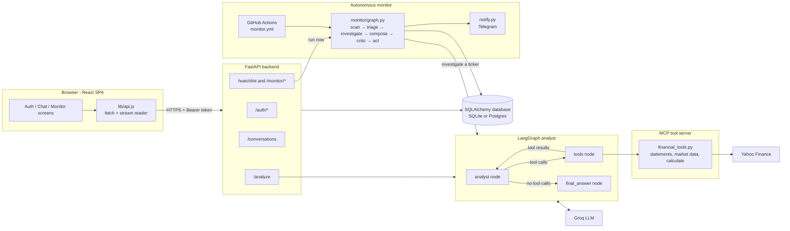
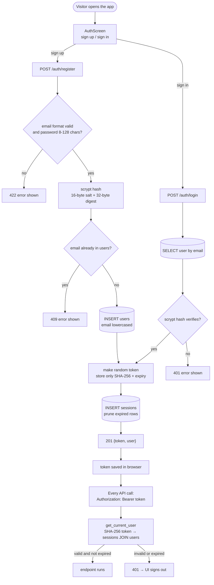
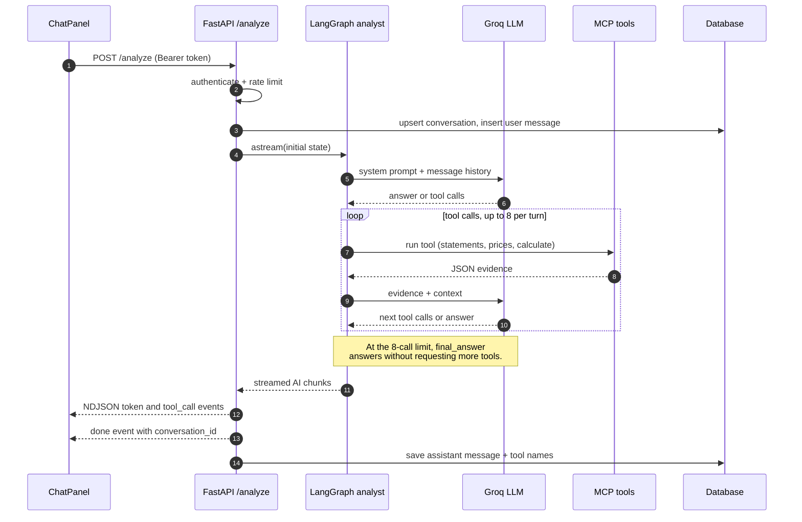
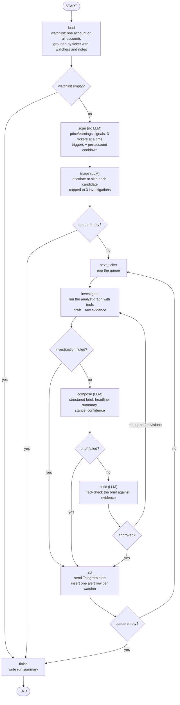
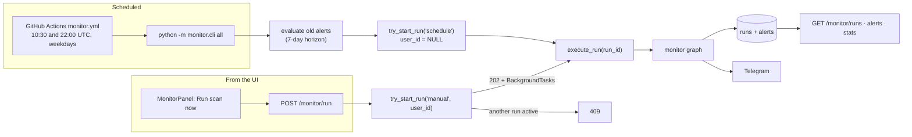
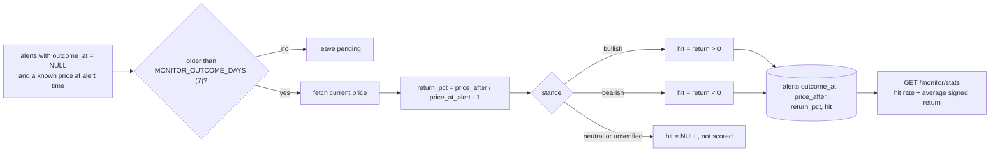
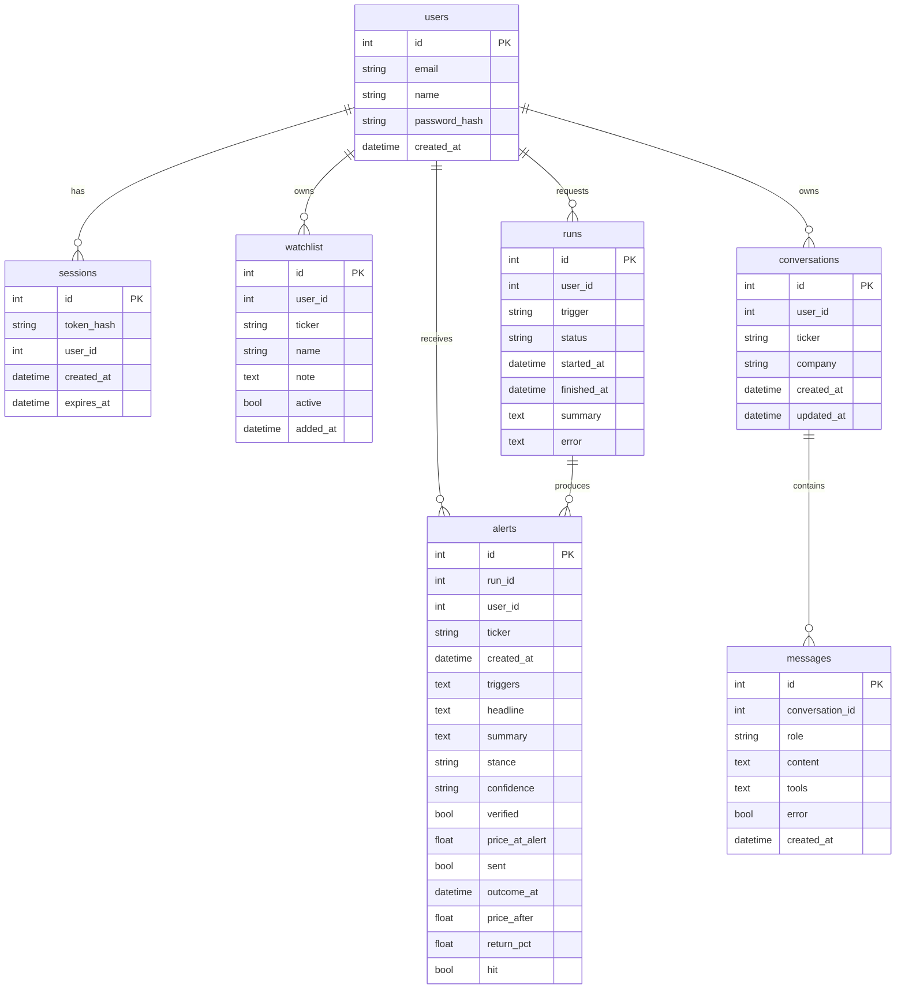

# Project Workflow

How a request moves through the Financial Analyst app, end to end. Each diagram is
[Mermaid](https://mermaid.js.org/) and renders automatically on GitHub and in VS Code
(with a Mermaid preview extension). The diagrams are followed by the exact steps and
the files that implement them.

At a glance:

```text
Browser ──► FastAPI (auth) ──► LangGraph analyst ◄──► Groq LLM
                                  │
                                  └──► MCP server ──► Yahoo Finance

GitHub cron / "Run scan now" ──► monitor graph (scan → triage → investigate →
compose → critic → act) ──► database + Telegram
```

---

## 1. System overview



**Startup sequence** (`main.py`, `auth.py`, `monitor/db.py`, `graph.py`):

1. `uvicorn main:app` imports the app. `analyst.py` calls `load_dotenv()`, then `main.py`
   fails fast if `GROQ_API_KEY` is missing.
2. FastAPI's lifespan calls `init_db()`: it normalizes `DATABASE_URL`
   (`postgres://` → `postgresql+psycopg://`), creates missing tables, upgrades
   pre-accounts databases, and drops the legacy shared watchlist table.
3. Routers for auth, history and the monitor are registered; CORS only allows the
   origins in `ALLOWED_ORIGINS`.
4. The MCP tool server and the analyst graph are **lazy**: nothing is started until
   the first `/analyze` (or the first monitor investigation). `create_graph()` starts
   `mcp_server/financial_tools.py` as a streamable-HTTP subprocess on `127.0.0.1:8931`;
   if it does not open the port within `MCP_STARTUP_TIMEOUT` (20 s), it falls back to
   stdio. The compiled graph is cached for the life of the process and `close_graph()`
   stops the subprocess on shutdown.

---

## 2. Accounts and sessions



Implementation details (`auth.py`, `monitor/db.py`):

- Passwords use stdlib **scrypt** (`n=2^14, r=8, p=1`, 16-byte random salt).
  Stored format: `scrypt:<salt hex>:<digest hex>`. Plaintext is never stored.
- Sessions are opaque `secrets.token_urlsafe(32)` tokens. Only the SHA-256 hash is
  stored, so a DB leak does not expose live sessions. Lifetime is
  `AUTH_SESSION_DAYS` (default 30); expired rows are pruned whenever a new session
  is created.
- `get_current_user` is a FastAPI dependency used by every protected route; it
  resolves the bearer token to a public user dict (`id, email, name, created_at`).
- Login and registration are rate-limited to 10/minute; auth responses never expose
  `password_hash`.
- Frontend (`AuthProvider.jsx`, `lib/api.js`): the token is kept in
  `localStorage` under `fa_session_token`; any `401` triggers a logout.

---

## 3. Asking a question (chat analysis)



Step by step (`main.py`, `graph.py`, `analyst.py`, `state.py`, `mcp_server/financial_tools.py`):

1. `ChatPanel` posts `{company, ticker, question, messages}` — at most 12 previous
   turns, 10 requests/minute.
2. Auth runs; then history is recorded **best effort** (`upsert_conversation` per
   user + ticker, insert the user message). A database failure logs and continues,
   so chat still works without a database.
3. `create_graph()` starts the MCP server (or reuses it), loads the five tools, and
   builds:

   ```text
   START → analyst ──(tool calls & under limit)──► tools ──► analyst
                 ├──(tool calls & limit reached)──► final_answer ──► END
                 └──(no tool calls)───────────────► END
   ```

4. `analyst` = ChatGroq (Groq) bound to the tools, with the financial-analyst system
   prompt. It may return text or tool calls.
5. `tools` = LangGraph `ToolNode` executing MCP tools: `get_financials`,
   `get_balance_sheet`, `get_cash_flow`, `get_market_data`, `calculate`.
   The server fetches from Yahoo Finance, caches results (`FIN_TOOL_CACHE_TTL`),
   retries rate limits, and returns strictly JSON-safe data.
6. The tool/analyst loop repeats at most **8 tool calls per turn** (`MAX_TOOL_CALLS`).
   At the limit, `final_answer` runs with the same prompt plus "answer from what you
   already have" and no tools bound. The graph recursion limit is 50.
7. The API streams with `graph.astream(..., stream_mode="messages")` and converts
   chunks to newline-delimited JSON:

   | Event | Payload | Meaning |
   | --- | --- | --- |
   | `token` | `{type, content}` | a piece of the answer |
   | `tool_call` | `{type, tool}` | a tool is being invoked (deduplicated) |
   | `done` | `{type, conversation_id}` | stream finished |
   | `error` | `{type, content}` | analysis failed; user sees a message |

8. In `finally`, the assistant text (plus tool names and an error flag) is saved to
   `messages`. The `done` event carries the conversation id used by the sidebar.
9. Errors in the model/MCP path produce an `error` event; the partial answer and a
   warning are still stored. The backend never crashes the stream.

---

## 4. Chat history

Per-account history (`history.py`, `monitor/db.py`):

| Action | Endpoint | Behavior |
| --- | --- | --- |
| List | `GET /conversations?limit=30` | newest first, with message count and last-message preview |
| Read | `GET /conversations/{id}` | ownership check (404 for someone else's), all messages |
| Delete | `DELETE /conversations/{id}` | deletes messages, then the conversation |
| Write | inside `/analyze` | `upsert_conversation` + `add_message` (best effort) |

One conversation exists per account and ticker (`UNIQUE(user_id, ticker)`); new
questions in the same ticker append to it.

---

## 5. Autonomous monitor

The monitor is a second LangGraph workflow that watches tickers and alerts when
something material happens. It runs on a schedule and on demand.

### 5.1 The monitor graph



### 5.2 What each step does

| Step | File | Behavior |
| --- | --- | --- |
| `load` | `monitor/graph.py` | Reads the watchlist. A manual run is scoped to `user_id`; a scheduled run has `user_id = NULL` and scans every account. Tickers watched by several accounts are grouped, keeping all watchers and notes. |
| `scan` | `monitor/signals.py` | Fetches 1 year of prices (3 concurrent) and computes 1-day move, 5-day move, distance from 52-week high/low, next earnings. **Primary triggers**: \|1d\| ≥ 4%, \|5d\| ≥ 8%, earnings within 3 days. Near-52-week values are context only. Each watcher's last alert is checked against a 24 h cooldown. |
| `triage` | `monitor/agents.py` | The LLM decides which candidates deserve a deep dive (at most `MONITOR_MAX_INVESTIGATIONS`, default 3), highest trigger score first. Rejections are recorded with a reason. |
| `investigate` | `monitor/graph.py` → `graph.py` | Builds a task from triggers, signals and user notes, then runs the full analyst graph with MCP tools. Collects the final draft plus the raw tool outputs as evidence. Failures do not abort the run. |
| `compose` | `monitor/agents.py` | Turns the draft into a structured brief (`headline`, `summary`, `stance` = bullish/bearish/neutral, `confidence`). |
| `critic` | `monitor/agents.py` | Fact-checks the brief against the raw evidence. If rejected, returns specific issues; the ticker goes back to `investigate` with that feedback, up to `MONITOR_MAX_REVISIONS` (default 2) rewrites. |
| `act` | `monitor/notify.py`, `monitor/db.py` | Verified brief → full alert. Unverified or failed → a signals-only alert that says it did not pass the fact-check (model claims are not stored or scored). Sends to Telegram, then inserts one `alerts` row per watcher so each account sees it. |
| `finish` | `monitor/graph.py`, `monitor/db.py` | Writes `runs.summary` (watchlist size, quiet count, candidates, alerts, skips, errors). If every ticker errored, the run is marked **failed** and an explicit notification is sent — silence would look like "nothing happened". |

Run statuses are `running → success | failed`. `try_start_run()` guarantees only one run
at a time and marks runs older than `MONITOR_RUN_STALE_MINUTES` (45) as failed.

### 5.3 Manual vs scheduled runs



- **Scheduled**: `.github/workflows/monitor.yml` runs `python -m monitor.cli all` on
  weekdays at 10:30 (after the Indian close) and 22:00 UTC (after the US close). The
  workflow fails immediately if the `DATABASE_URL` secret is missing; `GROQ_API_KEY`
  is also required. `all` = score old alerts, then scan every account's watchlist.
- **Manual**: "Run scan now" starts a background task and returns `202` with the
  `run_id`; the panel polls the monitor endpoints every few seconds while it runs.
- The app, the CLI and the GitHub Action all read the **same** `DATABASE_URL`; with
  a local SQLite file, scheduled runs and the deployed app would see different data.

### 5.4 Track record / outcome scoring



`evaluate_outcomes()` (run by `monitor.cli evaluate/all`, or `monitor/outcomes.py`)
walks pending alerts, fetches the price at the horizon, and stores the outcome.
`db.stats()` then reports alerts, verified count, scored count, hits, hit rate, and
average signed return (bearish returns are negated) for the signed-in account.

---

## 6. Data model



Relationships are logical (enforced in queries), not database foreign-key
constraints. Uniqueness: `users.email`, `sessions.token_hash`,
`watchlist(user_id, ticker)`, `conversations(user_id, ticker)`.
`runs.user_id` / `alerts.user_id` may be `NULL` for system/scheduled work.

---

## 7. File map

| Concern | Files |
| --- | --- |
| App wiring, CORS, lifespan, `/analyze` | `main.py` |
| Accounts and sessions | `auth.py`, `monitor/db.py`, `frontend/src/components/AuthScreen.jsx`, `AuthProvider.jsx` |
| Chat agent and tools | `graph.py`, `analyst.py`, `state.py`, `mcp_server/financial_tools.py` |
| Chat history | `history.py`, `monitor/db.py`, `frontend/src/components/Sidebar.jsx` |
| Ticker search | `user_input.py` (`/resolve`), `frontend/src/lib/use-ticker-search.js` |
| Monitor workflow | `monitor/graph.py`, `monitor/signals.py`, `monitor/agents.py` |
| Runs, alerts, stats | `monitor/runner.py`, `monitor/api.py`, `monitor/db.py` |
| Scheduling and scoring | `monitor/cli.py`, `monitor/outcomes.py`, `.github/workflows/monitor.yml` |
| Notifications | `monitor/notify.py` |
| Frontend data layer | `frontend/src/lib/api.js`, `auth-context.js`, `format.js` |
| UI screens | `frontend/src/App.jsx`, `components/ChatPanel.jsx`, `MonitorPanel.jsx`, `NewAnalysis.jsx`, `MessageBubble.jsx`, `Markdown.jsx`, `TickerSearch.jsx`, `ui.jsx` |
| Persistence | `monitor/db.py` (SQLAlchemy Core, SQLite/Postgres) |
| Tests | `tests/` (see README for the per-file breakdown) |

---

## 8. Viewing the diagrams

- **GitHub**: Mermaid blocks render inline in this file.
- **VS Code**: install a Markdown Mermaid extension (e.g. "Markdown Preview Mermaid
  Support") and open the preview.
- **Anywhere else**: copy a block into <https://mermaid.live>.
